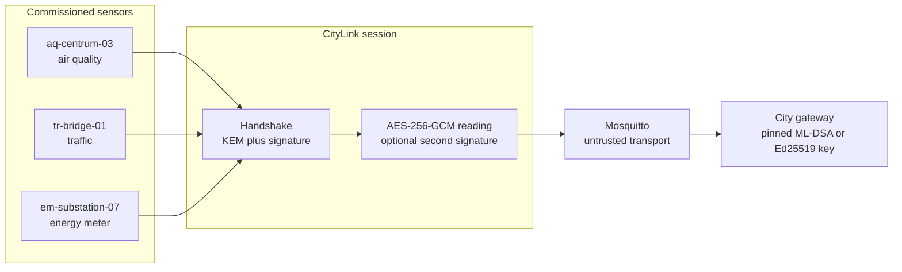
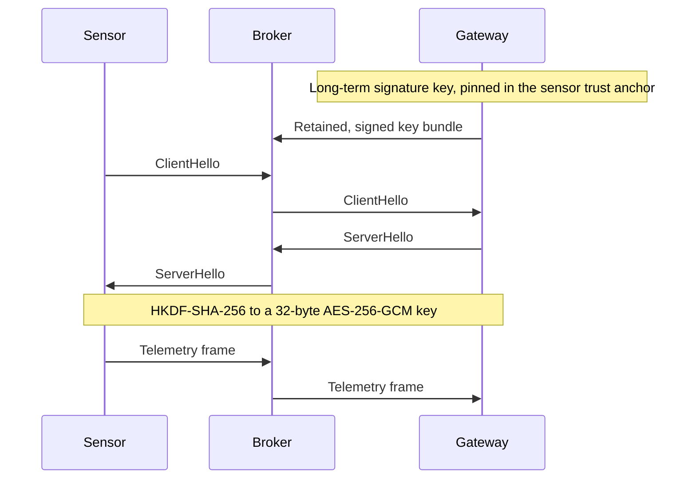
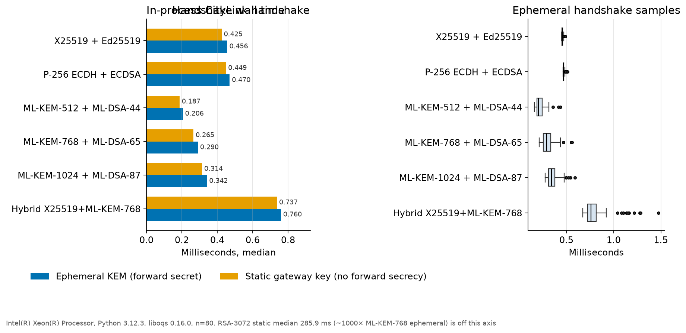
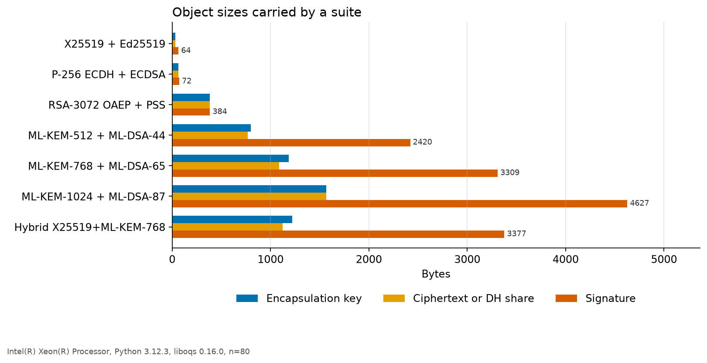
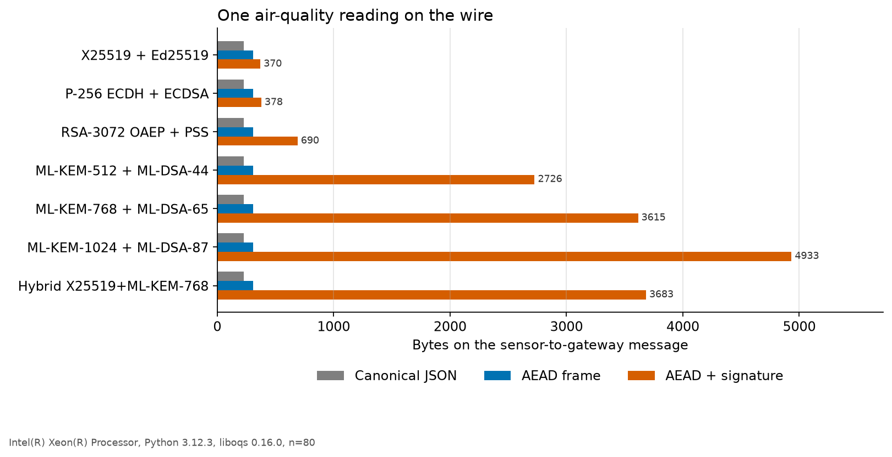
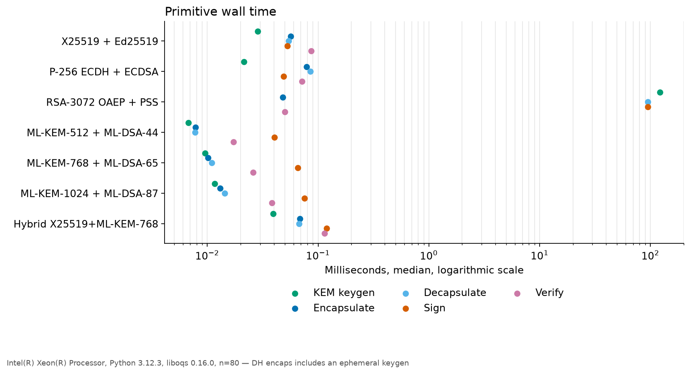

# PQC Smart City Lab

A measurement lab for post-quantum cryptography on a smart-city telemetry path. Simulated air-quality, traffic, and substation meters publish readings over MQTT. Each session is a small protocol called CityLink: ML-KEM for key establishment and ML-DSA for signatures, with classical suites beside them so the cost of the migration is visible in milliseconds and in bytes.

The author is Lukasz Paluch. The work sits in a PhD line of research on how smart-city infrastructure holds up once a cryptographically relevant quantum computer exists. This repository is a harness and a set of measurements. It is a proposal for what to count, and a running demo of that count.

## Motivation

Street cabinets, substations, and roadside units stay in the ground for ten to twenty years. The radio and the backhaul that tie them to a city platform are often protected by ECDH or RSA, then by AES. Two clocks matter more than the algorithm names.

Confidentiality has a harvest-now-decrypt-later problem. An adversary who records today's handshake can keep the ciphertext until a quantum computer can run Shor's algorithm against the elliptic-curve or RSA key establishment and recover the traffic key. Michele Mosca's planning inequality is the operational form of that fact: if the time the data must stay secret, plus the time a real deployment takes to migrate, exceeds the time until such a machine exists, the migration is already late. City platforms mix short-lived sensor readings with longer-lived material on the same tunnels: engineering access, firmware, and control traffic for signals and feeders. Fine-grained electricity traces also leak occupancy on their own (the non-intrusive load-monitoring literature, starting from Hart's 1992 result). The thing to protect is the key establishment on that shared path.

Signatures fail on a different clock. A recorded ECDSA signature does not become forgeable until the quantum computer exists, so signature harvest is a weaker reason to hurry than handshake harvest. It is still a reason. Devices commissioned this decade will still be verifying firmware and audit records when forgery of RSA and ECDSA becomes practical. ML-DSA is the tool for that later date. ML-KEM is the tool for traffic recorded now.

NIST finished the first three post-quantum standards on 13 August 2024:

- FIPS 203, ML-KEM, from CRYSTALS-Kyber. Key establishment.
- FIPS 204, ML-DSA, from CRYSTALS-Dilithium. Signatures.
- FIPS 205, SLH-DSA, from SPHINCS+. A hash-based signature kept as a diverse backup. It is not in this harness; its signatures are much larger.

The production migration for a TLS backhaul is already specified. RFC 10024 defines hybrid TLS 1.3 groups, including `X25519MLKEM768`, which concatenates an ML-KEM-768 shared secret with an X25519 shared secret. OpenSSL 3.5 implements that group. CityLink is not that protocol. It exists so the same objects can be timed on an MQTT-shaped sensor path, with the suite and the profile under the experimenter's control.

AES-256-GCM carries the reading after the handshake. A quantum search costs a square root, so a 256-bit symmetric key is the usual choice when the goal is a 128-bit post-quantum margin. The weak point in the recorded traffic is the handshake that produced the key, together with any classical signature that must still be unforgeable in twenty years.

## What the lab measures

For each suite and profile, one process records:

- handshake wall time and CPU time, initiator plus responder, with no network hop
- primitive wall time for key generation, encapsulation, decapsulation, signing, and verification
- encapsulation-key, ciphertext, and signature sizes, checked against the FIPS 203 and FIPS 204 tables for the ML-KEM and ML-DSA parameter sets
- client-hello and server-hello sizes
- the wire size of one canonical air-quality reading as plaintext, as an AEAD frame, and as an AEAD frame plus a signature

MQTT is in the demo and in the integration test. It is not in the timing loop. A broker adds jitter that would bury a sub-millisecond handshake.

## Architecture



The broker sees topics, packet lengths, and timing. It does not see the traffic key. Device public keys are commissioned out of band and pinned in a registry the gateway verifies with its own key. That is the laboratory stand-in for a commissioning ceremony, and it is much smaller than a certificate profile.



Two profiles exercise the forward-secrecy choice:

- **Ephemeral.** The sensor generates a KEM key pair and sends the encapsulation key. The gateway encapsulates to it. Both contributions are fresh. Compromise of the long-term signature keys later does not recover the traffic key. This is the profile to compare with ECDHE.
- **Static.** The sensor encapsulates to the gateway's long-term encapsulation key. The gateway can decrypt every recorded session if that decapsulation key leaks. RSA-3072 is offered only in this profile: a fresh RSA key pair per handshake is not an ECDHE analogue, and legacy meters really do encrypt to a long-term RSA key.

## Suites

| Suite | Key establishment | Signature | Security claim in this lab |
| --- | --- | --- | --- |
| `x25519-ed25519` | X25519 as a KEM | Ed25519 | Classical ~128-bit. Shor's algorithm breaks both. |
| `p256-ecdsa` | ECDH P-256 as a KEM | ECDSA P-256, SHA-256, DER | Same classical claim. The curve stack still common in operational gateways. |
| `rsa3072-pss` | RSA-3072 OAEP-SHA-256 | RSA-3072 PSS, SHA-256, 32-byte salt | Classical ~128-bit per SP 800-57. Static profile only. |
| `mlkem512-mldsa44` | ML-KEM-512 | ML-DSA-44 | Category 1 KEM with a category 2 signature. The sizes are tempting on a small meter; the categories do not match. |
| `mlkem768-mldsa65` | ML-KEM-768 | ML-DSA-65 | Both category 3. Default suite. Same KEM parameter as `X25519MLKEM768`. |
| `mlkem1024-mldsa87` | ML-KEM-1024 | ML-DSA-87 | Both category 5. |
| `hybrid-x25519-mlkem768` | ML-KEM-768 then X25519 | ML-DSA-65 and Ed25519 | Both secrets are concatenated and passed through CityLink's HKDF. Both signatures must verify. |

NIST security categories are not bit strengths. The hybrid suite is stricter than current TLS, which hybrids the key agreement and still uses a classical certificate. CityLink hybrids the signature as well, because a sensor that must authenticate readings to a gateway is holding a signing key, not a web PKI certificate.

X25519 and P-256 are modeled as KEMs the way HPKE's DHKEM is: the ciphertext is an ephemeral public key. CityLink then runs its own HKDF. The bytes are not an HPKE ciphertext and they are not a TLS key share. For the hybrid, the shared-secret order follows RFC 10024 (ML-KEM secret, then X25519 secret). The lab framing around those secrets is length-prefixed so the parser does not depend on a liboqs secret-key layout. A TLS stack should follow RFC 10024's own concatenation, which has no length prefixes.

ML-DSA signatures are made with the FIPS 204 context string `citylink-v1`, so a signature from this lab does not verify as a raw ML-DSA signature over the same bytes.

## Run it

The Python package needs a C toolchain the first time it imports `liboqs`. `liboqs-python` 0.16.0.1 builds liboqs 0.16.0 on that first import and caches it at `OQS_INSTALL_PATH` (default `$HOME/_oqs` when the variable is unset).

```bash
sudo apt-get install -y build-essential cmake ninja-build pkg-config libssl-dev
python3 -m venv .venv
source .venv/bin/activate
pip install -e ".[dev]"
export OQS_INSTALL_PATH="${OQS_INSTALL_PATH:-$HOME/_oqs}"
export LD_LIBRARY_PATH="$OQS_INSTALL_PATH/lib:${LD_LIBRARY_PATH:-}"
python -m pqc_smartcity versions
pytest
python -m pqc_smartcity demo --messages 2
```

The demo commissions three sensors in memory and prints one JSON object per accepted reading. `--all-suites` does one pass per suite. The `exchange_ms` column in that pass includes key generation, so it is a smoke test. The benchmark below is the measurement.

```bash
# The committed results/ directory was produced with the first command.
taskset -c 0 python -m pqc_smartcity bench --iterations 80 --warmup 10 --output results
python -m pqc_smartcity charts --results results
```

`make test`, `make bench`, and `make demo` are the same steps. `OQS_INSTALL_PATH` defaults to `/opt/liboqs` in the Makefile; override it if the library lives elsewhere.

### MQTT

```bash
python -m pqc_smartcity provision --suite mlkem768-mldsa65 --profile ephemeral
mosquitto -c deploy/mosquitto.conf
python -m pqc_smartcity gateway
python -m pqc_smartcity sensors --count 4 --interval 1
```

`provision` writes mode `0600` secrets for the gateway and the three sensors, plus a public trust anchor and a signed device registry. Run it again and it keeps the keys. `--force` rotates them, which invalidates every sensor that pinned the old anchor. The broker configuration allows anonymous clients because the security claim is about the CityLink payload. Do not publish that listener beyond a lab network.

### Docker Compose

```bash
docker compose up --build
```

Compose builds one image (Python 3.12, a C toolchain, and liboqs built on first import), starts Mosquitto, runs `provision` to completion, then starts the gateway and the sensor process. The gateway secret and the sensor secrets are on separate volumes; only the public trust directory is mounted into both. `CITYLINK_COUNT` defaults to 6 readings per sensor and `CITYLINK_SUITE` defaults to `mlkem768-mldsa65`. The sensor container exits after that count. The gateway keeps logging JSON lines until you stop it.

```bash
CITYLINK_SUITE=hybrid-x25519-mlkem768 CITYLINK_COUNT=3 docker compose up --build
```

`docker compose down -v` drops the volumes and the next `up` commissions a fresh fleet.

GitHub Actions (`.github/workflows/ci.yml`) installs the toolchain, runs `pytest` against a local `mosquitto`, and builds the image to execute `demo --messages 1`.

## Results

The tables and figures in `results/` were produced on 14 October 2026 by

```text
taskset -c 0 python -m pqc_smartcity bench --iterations 80 --warmup 10 --output results
```

Host: the virtual CPU reported as Intel Xeon, 4 threads, with AES-NI, AVX2, AVX-512F, and SHA-NI visible in `/proc/cpuinfo`. Python 3.12.3, liboqs 0.16.0, liboqs-python 0.16.0.1, cryptography 50.0.2. The process was pinned to one virtual CPU. Wall-clock medians and CPU medians match to about a microsecond, which is what a CPU-bound loop should do.

Method, also stored in `results/environment.json`: single-threaded CPython; `time.perf_counter_ns` for wall time and `time.process_time_ns` for CPU time; 10 warmup calls discarded; p95 is the nearest-rank statistic at `ceil(0.95 n)`. Handshake time is both peers in one process. Encapsulation for X25519 and P-256 includes generating the ephemeral key, because that is what the KEM call does. ML-KEM encapsulation does not generate a key. RSA-3072 key generation is capped at 8 iterations inside an 80-iteration run because it is a commissioning cost. Sign and verify primitives use a fixed 257-byte message. The air-quality size probe is sensor `aq-centrum-03`, sequence 1, canonical JSON, 228 bytes.

Absolute milliseconds belong to this machine and to these two native libraries behind a Python wrapper. A Cortex-M build, or a C TLS stack, will move the sub-millisecond numbers. The byte counts will not, apart from a byte or two of DER jitter on ECDSA.

### Handshake time



RSA-3072 is off the axis on purpose. Its static handshake median is **285.9 ms** (p95 287.1 ms). An ML-KEM-768 ephemeral handshake on the same run is **0.290 ms**. The ratio is about a thousand. The RSA figure is three private-key operations (the sensor signs, the gateway decapsulates, the gateway signs) at about 95 ms each, which is the primitive row for `rsa3072-pss`. The public operations are noise beside that.

Inside the sub-millisecond group the ordering is a property of this binding: liboqs's AVX-accelerated ML-KEM and ML-DSA, against cryptography's X25519, P-256, and Ed25519. ML-KEM-512 plus ML-DSA-44 is the fastest handshake in the run, at 0.206 ms ephemeral. The category-3 default is 0.290 ms. The hybrid is 0.760 ms. X25519 plus Ed25519 is 0.456 ms. Treat differences of a few tenths of a millisecond as "the same band." The p95 for the post-quantum and hybrid suites is wider than for X25519 (0.43 ms against a 0.29 ms median for ML-KEM-768; 1.17 ms against 0.76 ms for the hybrid). Eighty iterations on one virtual CPU are enough to rank RSA against everything else, and thin for explaining that tail.

Forward secrecy is cheap for ML-KEM on this host. The ephemeral profile adds about 0.025 ms to the category-3 handshake (0.290 ms against 0.265 ms static). The static profile gives that time back by giving up the property that a later compromise of the gateway decapsulation key cannot read recorded sessions.

### Object sizes



FIPS lengths, measured from liboqs rather than typed in. The tests assert these equalities.

| Algorithm | Public key | Secret key | Ciphertext or signature |
| --- | ---: | ---: | ---: |
| ML-KEM-512 | 800 | 1632 | 768 |
| ML-KEM-768 | 1184 | 2400 | 1088 |
| ML-KEM-1024 | 1568 | 3168 | 1568 |
| ML-DSA-44 | 1312 | 2560 | 2420 |
| ML-DSA-65 | 1952 | 4032 | 3309 |
| ML-DSA-87 | 2592 | 4896 | 4627 |

Classical counterparts in the same file (`results/primitives.csv`): X25519 and Ed25519 are 32-byte public keys, with a 32-byte DH share and a 64-byte signature. P-256 points are 65 bytes uncompressed and the ECDSA signature in this run peaked at 72 bytes (DER). RSA-3072 is a 384-byte modulus, a 384-byte ciphertext, and a 384-byte signature. The chart's hybrid signature is 3377 bytes: one ML-DSA-65 signature, one Ed25519 signature, and four bytes of length prefix.

The handshake messages follow from those objects. An ephemeral ML-KEM-768 client hello is **4543 bytes**, against **146 bytes** for X25519. The server hello is **4457 bytes**, against **156**. Moving from the static profile to the ephemeral profile grows the ML-KEM-768 client hello by 96 bytes, which is `1184 − 1088`, and grows the server hello by 1088 bytes, which is the ciphertext the static profile does not send. Those differences are a check that the framing is doing what the standard sizes say it should.

### Bytes per reading



The probe plaintext is 228 bytes. AES-256-GCM, a 12-byte counter nonce, the header, and a two-byte empty signature field bring the AEAD frame to **306 bytes**. Adding an ML-DSA-65 signature brings it to **3615 bytes**, about sixteen times the JSON. Ed25519 stops at **370 bytes**. The hybrid frame is **3683 bytes**, sixty-eight bytes over the pure category-3 frame, because the extra Ed25519 signature is small beside ML-DSA-65.

A live demo reading is a few tens of bytes longer or shorter when the sensor kind or the decimal width changes (the three sensors in one local run produced 3615, 3575, and 3625 byte frames). The signature, not the JSON, sets the scale.

That is the deployment fact worth taking out of the lab. On this CPU, signing with ML-DSA-65 costs well under a tenth of a millisecond, and the ephemeral KEM adds almost nothing. The cost that moves a low-rate radio, a duty-cycled meter, or a cellular backhaul is the signature on every reading. AEAD-only telemetry after an authenticated handshake is the bandwidth-cheap choice, and it gives the gateway integrity and replay protection. It does not give a third party a signature it can check without the traffic key. Batching readings under one ML-DSA signature is the obvious next design if an auditor needs that property and the radio does not.

### Primitive CPU



| Suite | KEM keygen (ms) | Encaps (ms) | Decaps (ms) | Sign (ms) | Verify (ms) |
| --- | ---: | ---: | ---: | ---: | ---: |
| x25519-ed25519 | 0.029 | 0.056 | 0.054 | 0.053 | 0.086 |
| p256-ecdsa | 0.021 | 0.079 | 0.085 | 0.049 | 0.072 |
| rsa3072-pss | 122.629 | 0.048 | 95.290 | 95.135 | 0.050 |
| mlkem512-mldsa44 | 0.007 | 0.008 | 0.008 | 0.040 | 0.017 |
| mlkem768-mldsa65 | 0.010 | 0.010 | 0.011 | 0.065 | 0.026 |
| mlkem1024-mldsa87 | 0.012 | 0.013 | 0.014 | 0.076 | 0.038 |
| hybrid-x25519-mlkem768 | 0.039 | 0.068 | 0.068 | 0.119 | 0.115 |

ML-KEM key generation is the cheap operation in this build, including ML-KEM-1024 at 0.012 ms. The reason to hesitate over the ephemeral profile on a server-class core is not CPU. ML-DSA signing is the post-quantum CPU term that shows up, and at category 3 it is 0.065 ms on the 257-byte probe. The handshake is a little slower than the sum of those probes because the signed transcript contains a thousand-byte encapsulation key rather than 257 bytes of filler.

X25519 "encapsulation" at 0.056 ms includes the ephemeral key generation. Comparing it with ML-KEM encapsulation at 0.010 ms without that caveat would overstate the gap.

Per-iteration samples are in `results/samples.csv`. The full median, mean, stdev, p95, min, and max table is `results/summary.md`.

## Limitations

CityLink has no security proof and no independent review. The composition is the obvious one: verify the signature over the handshake bytes, then encapsulate or decapsulate, then HKDF-SHA-256, then AES-256-GCM with the sequence number as the nonce. ML-KEM's implicit rejection means a tampered ciphertext still decapsulates to a pseudorandom secret; the signature check is what rejects it. RSA-OAEP reports a padding failure instead. Both paths abort the handshake. None of that is a proof that the composition is safe, and the HKDF labels are CityLink's, not TLS's.

Python does not zeroize ephemeral secrets. The ephemeral profile's forward secrecy assumes those bytes are gone after the handshake. CPython cannot promise that.

The timing loop is one virtual CPU and one Python process. It excludes MQTT, radio, and the cost of waking a meter. Sub-millisecond rankings are specific to liboqs 0.16.0 and cryptography 50.0.2 as built here. liboqs picked its implementations for a host that advertises AVX-512. An embedded build can reverse the CPU comparison without changing a single length in the FIPS tables.

ECDSA signatures are DER, so the P-256 telemetry frame moved between 377 and 378 bytes across the two profiles. Everywhere else in this run the sizes were stable.

The device registry is a file signed by the gateway. There is no revocation, no certificate path, and no secure element. Secret keys are JSON with mode `0600`. The replay window is a 4096-entry nonce cache and a strictly increasing sequence number, so a reordered reading is dropped. The default clock skew window is five minutes of wall time, which is not a secure time source. Topics and packet lengths remain visible to the broker and to anyone on the path.

SLH-DSA (FIPS 205) and the unfinished FN-DSA draft (FIPS 206, from Falcon) are outside the harness. So is a real TLS 1.3 stack. For a city backhaul that has to carry production traffic, the object to deploy is a maintained TLS 1.3 with `X25519MLKEM768`, plus a plan for device identity that outlives the hardware.

## Built with Codex

This lab was built with OpenAI Codex as a portfolio piece for that research. Codex drafted the CityLink framing, the classical and liboqs adapters, the benchmark harness, the MQTT roles, the tests, the container packaging, and this note. The FIPS 203 and FIPS 204 lengths are asserted by `tests/test_primitives.py` against the running liboqs, and the numbers in `results/` are the output of the harness on the host above. The timings were not filled in by the model.

## References

- NIST FIPS 203, *Module-Lattice-Based Key-Encapsulation Mechanism Standard*, 13 August 2024. <https://doi.org/10.6028/NIST.FIPS.203>
- NIST FIPS 204, *Module-Lattice-Based Digital Signature Standard*, 13 August 2024. <https://doi.org/10.6028/NIST.FIPS.204>
- NIST FIPS 205, *Stateless Hash-Based Digital Signature Standard*, 13 August 2024. <https://doi.org/10.6028/NIST.FIPS.205>
- M. Mosca, "Cybersecurity in an Era with Quantum Computers: Will We Be Ready?", *IEEE Security & Privacy*, 2018. <https://doi.org/10.1109/MSP.2018.3761723>
- G. W. Hart, "Nonintrusive Appliance Load Monitoring", *Proceedings of the IEEE*, 1992. <https://doi.org/10.1109/5.192069>
- RFC 10024, *Post-Quantum Traditional Hybrid Key Agreement for TLS 1.3*. The `X25519MLKEM768` group.
- RFC 9180, *Hybrid Public Key Encryption*. The DHKEM shape used as a model for the classical KEMs here.
- liboqs and liboqs-python, Open Quantum Safe. <https://github.com/open-quantum-safe/liboqs-python>

## License

MIT. Copyright 2026 Lukasz Paluch. See [LICENSE](LICENSE).
